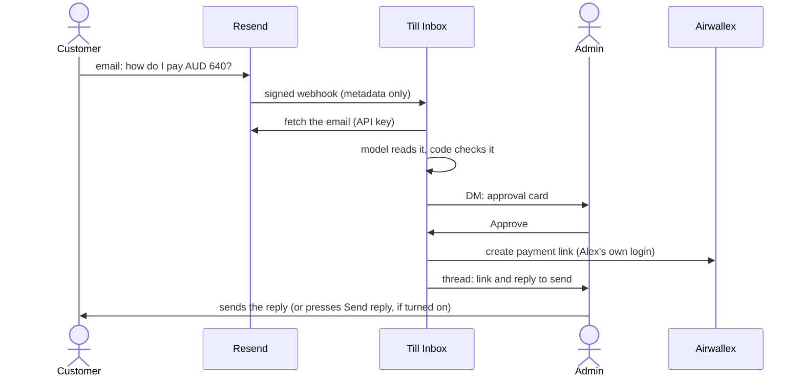

# Till Inbox

A customer emails asking how to pay. Till Inbox reads the email, works out what they want to pay
for and how much, and asks an admin in Slack. When the admin approves, it creates an Airwallex
payment link with the admin's own Airwallex login and writes the reply, with the link, for the admin
to send. Nothing is created before the approval, and nothing goes to the customer unless an admin
sends it.

> **Disclaimer.** Till Inbox is an open-source sample built on Airwallex. It is not an official
> Airwallex product and is not supported by Airwallex. It is provided as is, without warranty, under
> the Apache License 2.0. It runs against the Airwallex sandbox by default. Its author ran it end to
> end once, on 13 November 2026, on the Airwallex sandbox with a real inbox and a real Slack
> workspace; it has not been used with real customers or a production Airwallex account. Read the
> full [Disclaimer](#disclaimer) before you use it with real customers or a live Airwallex account.


A recording of a real run on the Airwallex sandbox, 13 November 2026: a real email through Resend,
real Slack cards and buttons, and real sandbox payment links. The companies and people are made up.
The full video also shows an email with two numbers, where the admin types the amount, and an email
that tries to give the AI orders. [Watch it as a video](docs/demo.mp4).

Till Inbox is the email version of [Till](https://github.com/Cyvid7-Darus10/till) and
[Till in DMs](https://github.com/Cyvid7-Darus10/till-dm). It reaches Airwallex through the Airwallex
MCP server. [Vercel Connect](https://vercel.com/docs/connect) holds the Slack and Airwallex logins.
Only the email provider needs keys: an API key and a webhook secret.

```
DM: Alex and Till Inbox
  Till Inbox  [Payment link for North Beach Deli]
              From: Noah Lee, North Beach Deli, accounts@northbeachdeli.example
              Sender check: Passed DMARC
              For: this week's Lane House Blend · Amount: AUD 640.00 · Amounts mentioned: AUD 640
              (Approve) (Edit amount) (Reject)
  Alex        presses Approve
  Till Inbox  Approved by Alex. Creating the payment link.
     thread   Created a single-use payment link for AUD 640.00.
              Reply to send to the customer. Copy it into your email. Nothing was sent.
              > Hi Noah, ... https://pay.sandbox.airwallex.com/...
              (Open payment link) (Has it been paid?)
```

> **What is real**
>
> Run end to end on 13 November 2026 on the Airwallex sandbox, with a production deployment, a real
> Resend inbox and a real Slack workspace. All four example emails became approval cards. One-click
> Approve created one link, and "Has it been paid?" read its status. "Set amount" worked for the
> email with several numbers. The injection email was flagged. Two Approve clicks at once created
> one link, and a replayed webhook was ignored. Unsigned webhook requests were refused.
>
> Not run for real: sending the reply by email (`TILL_SEND_REPLY_EMAIL`, off by default), more than
> one admin, a live Airwallex account, and real customers. The full record is in
> [docs/first-real-run.md](docs/first-real-run.md).

## Try it without any accounts

This runs the whole flow on an example email, with stand-ins for Slack, Airwallex and Resend:

```bash
npm install
npm run simulate -- fixtures/emails/single-amount.json   # one plain amount: one-click Approve
npm run simulate -- fixtures/emails/opening-order.json   # several numbers: an admin types the amount
npm run simulate -- fixtures/emails/no-amount.json       # no amount: an admin has to set one
npm run simulate -- fixtures/emails/injection.json       # the email tries to rewrite the amount and the recipient
```

Add `--step` to pause between steps. The model's reading comes from the fixture, recorded from a real
run. Add `--live-model` to call the model instead (needs `vercel env pull`, see [Develop](#develop)).

## How it works



- **One-click Approve is narrow.** The model only points at the amount. Code reads it from the email
  and offers Approve only when the email has exactly one plain amount with its currency, and it
  matches the model's reading. Otherwise the card shows "Set amount" and "Reject", and the admin
  types the amount before approving.
- **The email is untrusted.** The webhook signature is checked first. The model gets no tools. An
  email that tries to instruct the AI is flagged and gets no one-click Approve. Text from the email
  is stripped of links and markup before it reaches Slack, Airwallex or the reply.
- **Only admins decide, once.** Every click is checked again. The first Approve or Reject closes
  every card. Before creating a link, the app reuses any link that already carries this request's
  reference.
- **Nothing is sent by default.** The reply appears in the Slack thread for the admin to copy. The
  link is created without the customer's email, so Airwallex does not email them either.

The full amount rule and the security notes are in [docs/how-it-decides.md](docs/how-it-decides.md).
To report a security problem, see [SECURITY.md](SECURITY.md).

## Who can do what

- **The customer** emails your receiving address, and hears nothing until an admin sends the reply.
- **An admin** (listed in `TILL_ADMIN_SLACK_IDS`, at most 5) approves, edits the amount or rejects,
  in a DM, with their own Airwallex login. They can also press "Has it been paid?" under a link, and
  "Send reply" when sending is on.
- **Anyone else** can do nothing. Cards go only to admins' DMs, and other clicks do nothing.

## Set it up

You need a Vercel team with Vercel Connect (the model runs through Vercel AI Gateway), a Slack
workspace where you can install apps, an Airwallex sandbox account, and a [Resend](https://resend.com)
account. Resend's `<id>.resend.app` receiving address means you don't need your own domain.

1. Deploy this repository to Vercel as a new project (Node 22 or later).
2. In the project, open Connect and add a Slack connector named `slack/till-inbox`, with triggers
   turned on, and install it in your workspace. Then, from this folder:
   `vercel connect attach slack/till-inbox --triggers --trigger-path /api/webhooks/slack`.
3. Add an MCP connector for `https://mcp.sandbox.airwallex.com/developer` named
   `airwallex/till-sandbox`, or attach an existing one: `vercel connect attach airwallex/till-sandbox`.
4. In Resend, open Emails > Receiving and copy your receiving address. Under Webhooks, add an
   endpoint `https://<your-project>.vercel.app/api/webhooks/email` for the `email.received` event,
   and copy its signing secret. Create an API key that can read received emails.
5. Set these in Project Settings > Environment Variables, then redeploy:

   | Variable                    | What it is                                                                   |
   | --------------------------- | ---------------------------------------------------------------------------- |
   | `TILL_ADMIN_SLACK_IDS`      | Slack member ids of the admins who approve, comma-separated, at most 5       |
   | `RESEND_API_KEY`            | Secret. Reads the received email (and sends the reply, if turned on)         |
   | `RESEND_WEBHOOK_SECRET`     | Secret. The `whsec_...` signing secret of the Resend webhook                 |
   | `TILL_STATE_SECRET`         | Secret. Signs what the Slack buttons carry. `openssl rand -base64 32`        |
   | `TILL_AIRWALLEX_ACCOUNT_ID` | Optional. Which Airwallex account gets the links, if your login sees several |
   | `TILL_COMPANY_NAME`         | Optional. Signs the reply                                                    |

   `.env.example` lists every setting with its default. The server refuses to start if one is
   missing or invalid, and names the variable.
6. Email your Resend address asking how to pay. Each admin gets the card in a DM. The first Approve
   asks the admin to connect their Airwallex sandbox.

To remove an admin, take out their id and redeploy, and revoke their grant in Vercel Connect.

## Develop

```bash
npm install
vercel link
vercel env pull .env.local   # the OIDC token for Vercel Connect and AI Gateway, plus your settings
npm run dev
```

| Command                           | What it does                                                                         |
| --------------------------------- | ------------------------------------------------------------------------------------ |
| `npm run check`                   | Type check, lint, and tests with coverage                                            |
| `npm run read-email -- <fixture>` | The real model on one fixture email. Sends nothing                                   |
| `npm run live-link -- <fixture>`  | Creates one real sandbox payment link, checks it is reused, and reads its status     |

Vercel Connect saves Airwallex logins per environment, so a login made from your laptop (development)
does not exist in production. A map of the code, and how to swap the email provider or chat tool, is
in [docs/code-tour.md](docs/code-tour.md).

## Limits

- Built for an Airwallex sandbox. Review the scopes and the code before you allow a live account.
- The replay cache, rate limits and click lock live in memory, per server instance. Two clicks on
  different instances in the same second could both reach Airwallex. Add a shared store such as
  Redis, and a Vercel Firewall rate limit rule on `/api/webhooks/email`, before heavy use.
- The per-sender limit keys on the From address, which a sender can forge or change on every email.
  Each email that gets through costs one model call, so set a spend limit in AI Gateway.
- Most real emails with line items, unit prices or several figures will need a typed amount.
- Only the first 8,000 characters of an email are read, and the card says when it was cut.
- An email whose plain-text and formatted versions show different numbers needs a typed amount.
- One link per email. A reply in the same thread is a new email and a new card.
- At most five admins, because every card's buttons list every card.
- If Airwallex returns a link that doesn't match the approval, the app says "Don't send it" but
  cannot deactivate the link. Deactivate it in Airwallex.
- The model can be wrong. Read the email and the card before you press Approve.

Smaller limits are listed in [docs/how-it-decides.md](docs/how-it-decides.md#smaller-limits).

## Disclaimer

- Till Inbox is an open-source sample built on Airwallex. It is not an official Airwallex product,
  and Airwallex does not support it.
- It is provided as is, without warranty of any kind, under the Apache License 2.0. See sections 7
  and 8 of the [LICENSE](LICENSE).
- It runs against the Airwallex sandbox by default. Its author ran it end to end once, on 13
  November 2026, on the Airwallex sandbox with a real inbox and a real Slack workspace. It has not
  been used with real customers or a production Airwallex account. The "What is real" box above says
  which parts have been run, and when.
- It reads email from anyone on the internet and creates payment links. If you deploy it, you are
  responsible for your own review, security, compliance, data-protection obligations and testing
  before you use it with real customers or a production Airwallex account.
- Nothing in it is financial, legal or compliance advice.
- Airwallex, Slack, Vercel, Resend, OpenAI and other names are trademarks of their owners. They are
  used only to describe what this sample connects to.

## License

Apache License 2.0. If you use or adapt this code, keep the [NOTICE](NOTICE) file, which credits
Cyrus David Pastelero, as the license requires. See [LICENSE](LICENSE).
