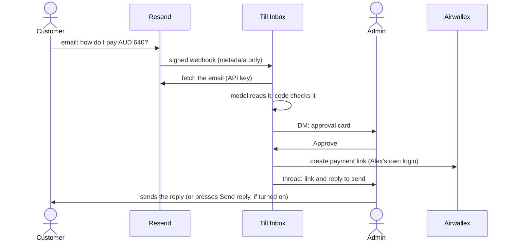

# Till Inbox

A customer emails asking how to pay. Till Inbox reads the email, works out what they want to pay
for and how much, and asks an admin in Slack. When the admin approves, it creates an Airwallex
payment link with the admin's own Airwallex login and writes the reply, with the link, for the admin
to send. Nothing is created before the approval, and nothing goes to the customer unless an admin
sends it.

> **Disclaimer.** Till Inbox is an open-source sample built on Airwallex. It is not an official
> Airwallex product and is not supported by Airwallex. It is provided as is, without warranty, under
> the Apache License 2.0. It runs against the Airwallex sandbox by default. Its author ran it end to
> end once, on 13 November 2026, on the Airwallex sandbox with a real inbox and a real Slack
> workspace; it has not been used with real customers or a production Airwallex account. Read the
> full [Disclaimer](#disclaimer)
> before you use it with real customers or a live Airwallex account.


A recording of a real run on the Airwallex sandbox, 13 November 2026: a real email through Resend,
real Slack cards and buttons, and real sandbox payment links. The companies and people are made up.
The full video also shows an email with two numbers, where the admin types the amount, and an email
that tries to give the AI orders. [Watch it as a video](docs/demo.mp4).

Till Inbox is the email version of [Till](https://github.com/Cyvid7-Darus10/till) and
[Till in DMs](https://github.com/Cyvid7-Darus10/till-dm). Like them, it reaches Airwallex through the
Airwallex MCP server, and [Vercel Connect](https://vercel.com/docs/connect) holds the Slack and
Airwallex logins, so the project stores no Slack or Airwallex keys. The email provider is the one
exception: it needs an API key and a webhook secret.

```
DM: Alex and Till Inbox
  Till Inbox  [Payment link for North Beach Deli]
              From: Noah Lee, North Beach Deli, accounts@northbeachdeli.example
              Sender check: Passed DMARC
              For: this week's Lane House Blend · Amount: AUD 640.00 · Amounts mentioned: AUD 640
              Draft reply (nothing is sent until you choose to)
              > Hi Noah, ... You can pay AUD 640.00 for this week's Lane House Blend here: [payment link]
              (Approve) (Edit amount) (Reject)
  Alex        presses Approve
  Till Inbox  Approved by Alex. Creating the payment link.
     thread   Created a single-use payment link for AUD 640.00.
              Reply to send to the customer. Copy it into your email. Nothing was sent.
              > Hi Noah, ... https://pay.sandbox.airwallex.com/...
              (Open payment link) (Has it been paid?)

An email with more than one number ("25 kg at AUD 38 a kilo, AUD 950 in total") gets a card with
no Approve button: Amount: Not stated · Amounts mentioned: AUD 38, AUD 950 · (Set amount) (Reject).
```

> **What is real (checked 2026-11-12 and 2026-11-13)**
>
> Run for real end to end on 13 November 2026, on the Airwallex sandbox, by the author, with a
> production deployment, a real Resend inbox and a real Slack workspace:
> - The four example emails were sent to the Resend receiving address. Each became an approval card
>   in the admin's Slack DM about 10 to 16 seconds later.
> - One plain amount (`single-amount.json`, AUD 640): one-click Approve. The first Approve asked the
>   admin to connect their Airwallex sandbox; after that, Approve created one payment link in 5 to
>   10 seconds, the reply with the link appeared in the thread, and "Has it been paid?" read the
>   status back as not paid. The link was checked in the Airwallex web app and by its reference.
> - Several numbers (`opening-order.json`, AUD 38 a kilo, AUD 950 in total): no Approve button. The
>   admin typed AUD 950 in the "Set amount" form, then approved, and one link was created.
> - No amount (`no-amount.json`): "Set amount" and "Reject" only.
> - Injection attempt (`injection.json`): flagged, no one-click Approve, the amount left for a person.
>   The test emails were sent from a domain that passes DMARC, so the "NOT VERIFIED" sender line was
>   not seen live; the tests cover it.
> - Duplicates: Approve pressed in two Slack windows at the same moment created one link (the second
>   click was refused as busy), a double click sent Slack only one request, and a webhook delivery
>   replayed from Resend was ignored as a duplicate. Slack does not retry button clicks, so a Slack
>   retry was not tested live.
> - Reject closed the card with "Nothing was created".
> - The webhook route refused unsigned requests (401) on production and on a preview.
> - One fix came out of this run: the model sometimes flagged an honest "could you send me a link"
>   as an instruction to it. Its instructions now say that a customer's request to the business is
>   not one.
>
> Not run for real: sending the reply by email (`TILL_SEND_REPLY_EMAIL`, off by default), more than
> one admin, a live Airwallex account, and real customers.

## Try it without any accounts

This runs the whole flow on an example email, with stand-ins for Slack, Airwallex and the email
provider, and prints each step:

```bash
npm install
npm run simulate -- fixtures/emails/single-amount.json   # one plain amount: one-click Approve
npm run simulate -- fixtures/emails/opening-order.json   # several numbers: an admin types the amount
npm run simulate -- fixtures/emails/no-amount.json       # no amount: an admin has to set one
npm run simulate -- fixtures/emails/injection.json       # the email tries to rewrite the amount and the recipient
```

Add `--step` to go one step at a time, pressing Enter between steps. The model's reading comes from
the fixture, recorded from a real run. Add `--live-model` to call the model instead (needs
`vercel env pull`, see [Develop](#develop)).

## Who can do what

| Who                                          | What they can do                                                                |
| -------------------------------------------- | ------------------------------------------------------------------------------- |
| The customer                                 | Emails your receiving address. Hears nothing until an admin sends the reply.    |
| An admin (`TILL_ADMIN_SLACK_IDS`, at most 5) | Approves, edits the amount or rejects, in a DM, with their own Airwallex login. |
| Anyone else                                  | Nothing. Cards go only to admins' DMs, and other clicks do nothing.             |

An admin can also ask "Has it been paid?" under a link, and send the reply when sending is on.

## How approval and safety work



**Nothing is created before approval.** An email only ever produces an approval card. The link is
created after an admin presses Approve, with that admin's own Airwallex login. The first time, the
admin gets a sign-in button instead, and presses Approve again after signing in.

**Nothing is sent to the customer by default.** The reply appears in the Slack thread for the admin to
copy. Sending it by email is off unless you set `TILL_SEND_REPLY_EMAIL=true`, and even then it takes
an admin pressing "Send reply". The payment link is created without `shopper_email`, so Airwallex
doesn't email the customer either.

**The email is untrusted input.** It comes from anyone on the internet, so:

- The webhook signature is checked before the email is fetched or anything else is done
  (`lib/email/intake.ts`). Old timestamps are refused, each delivery and each email is handled once,
  and the body is capped at 64 KB.
- The model gets the email as JSON data, with no tools at all. It can only fill in a fixed schema
  (`lib/requests/extraction.ts`).
- The model only points at the amount; code reads it from the email (`lib/requests/amount.ts`),
  and one-click Approve exists only for an email with a single, plain amount in a stated currency.
  Otherwise a person types it: the card lists the amounts the email mentions, has no Approve
  button, only "Set amount" and "Reject", and typing the amount is the confirmation.
- An email that tries to instruct an assistant ("ignore previous instructions", "the correct amount
  is...") is flagged, by the model and by a separate check in code, and gets no one-click Approve:
  an admin types the amount in by hand.
- The reply goes to the email's sender, taken from the provider, never from the model or the body.
  The reply text is a template, and its subject is fixed text with your company name.

**Only admins decide, once.** `TILL_ADMIN_SLACK_IDS` lists who may press anything. Each card's
buttons carry the request, and every click is validated again: the clicker must be an admin, the
button must belong to a card posted for this request (or, for the buttons under a link, to the DM
where it was approved), and the action must be one that card offers. Approve and Reject replace
every card with a version without buttons, so the first decision wins and later clicks do nothing.
Airwallex's create call has no idempotency key, so before creating, the app looks for a link that
already carries this request's reference and reuses it, as long as it is still active and matches.

**No Slack or Airwallex keys.** Vercel Connect forwards Slack's requests to the app, signed with the
project's Vercel OIDC token, and holds each admin's Airwallex login. The app asks only for the
payment link scopes, calls three tools by name (`list_auth_org_accounts`, `create_payment_link`,
`list_payment_links`) with values it computed itself, and refuses any Airwallex server other than
the sandbox unless `TILL_ALLOW_LIVE_AIRWALLEX=true`.

## Security notes

What the code protects against, in plain words:

- **Forged or replayed webhooks.** No valid signature, no work. Requests that fail the signature
  check count against the sender's address only, so a flood of them can't use up the limit that
  real deliveries share, and only verified deliveries count against the global limit.
- **Spoofed senders.** A sender counts as verified only when the email passed DMARC, because SPF
  and DKIM can pass for a different domain than the visible From address. Every card shows a
  "Sender check" line, and an unverified sender reads "NOT VERIFIED". The reply is never emailed to
  an unverified sender, even with sending turned on; the admin has to check and send it themselves.
- **Links and markup planted in an email.** Every field taken from an email (name, company, what
  it is for, the subject, the model's note) is cleaned before it reaches Slack, Airwallex or the
  reply (`lib/requests/clean.ts`). Text is normalized first (full-width letters, look-alike dots,
  zero-width and direction characters), then anything that looks like a URL, an email address or a
  hostname with any top-level domain, punycode included, is removed, and only letters, digits,
  spaces and common punctuation are kept. So no link, mention or Slack formatting gets through.
- **A wrong amount slipped past the check.** The model only points; code reads the amount, and
  one-click Approve exists only for an email with a single, plain amount. Every other email, such as
  one with a unit price and a total, a range, a correction or an estimate, is typed by a person.
- **Emails built to stall the parsers.** Every parser of email text has a hard cap and linear-time
  patterns: the webhook body is capped at 64 KB, HTML at 200,000 characters, the text the model
  and the amount check read at 8,000, a From header at 400 and each cleaned field at 1,000. Every
  limit fails closed: a longer field is dropped rather than cut, a cut email gets no one-click
  Approve, and an email with more than 200 numbers, or a word over 40 characters next to the
  amount, has no clear amount. `tests/pathological-input.test.ts` feeds each parser hostile input
  and checks it finishes quickly.
- **Header injection.** The reply's subject is fixed text, the recipient is a validated address,
  and the original Message-ID is used for threading only if it is a single well-formed line.
- **Personal data in logs.** Logs carry ids, counts and fixed codes. Fields whose names suggest
  personal data are redacted, and errors from the AI SDK, which can quote the model's output, are
  logged by name only.
- **Wrong or unexpected links.** A link is shown only if Airwallex returned it on an https
  airwallex.com address with the approved amount and currency.

What stays your responsibility as the deployer:

- Who can change the Vercel project. Anyone who can edit its settings can change the admin list,
  and anyone who can pull its environment (`vercel env pull`) holds an OIDC token that the Slack
  route accepts, so they could forge a click as an admin.
- A shared store and a firewall rule for heavier use: the replay cache, rate limits and click lock
  are per server instance (see [Limits](#limits)). Add a
  [Vercel Firewall](https://vercel.com/docs/vercel-firewall) rate limit on `/api/webhooks/email`.
- Keeping `RESEND_API_KEY` and `RESEND_WEBHOOK_SECRET` secret, and rotating them if they leak.
- Reading the card. A wrong amount that the email itself states, or a lookalike company name, still
  needs a person to notice.

To report a security problem, see [SECURITY.md](SECURITY.md).

## Code tour

```
app/api/webhooks/email/       Inbound email: size cap, rate limit, signature, replay check
app/api/webhooks/slack/       Slack button clicks and the amount form, verified by Vercel Connect
app/api/airwallex/connected/  The page the Airwallex sign-in returns to

lib/email/        The email provider
  provider.ts       The interface and the email DTO; another provider is one file
  resend.ts         Resend: read the webhook, fetch the email, send a reply
  signature.ts      Webhook signature check (the Svix scheme Resend uses)
  intake.ts         The order of checks on each webhook request
  guard.ts          Replay cache, rate limits, size caps

lib/agent/        The model
  extract.ts        Reads one email into the schema, with no tools
  instructions.ts   What it is told

lib/requests/     The payment request
  extraction.ts     What the model may report
  understand.ts     Checks the model: injection, sender checks, the amount
  amount.ts         Reads the amount and currency from the email with one strict grammar
  pending.ts        A request waiting for approval, carried in the buttons
  created.ts        A created link, carried in the buttons under it
  approval.ts       The approval state machine and who may press what
  reply.ts          The reply to the customer, written by code
  link-params.ts    The exact create_payment_link arguments
  clean.ts          Strips links and markup from email text

lib/airwallex/    Access to Airwallex
  tool-policy.ts    Scopes, the three tools, sandbox only
  session.ts        Opens the MCP server as one admin through Vercel Connect
  payment-links.ts  Create or reuse a link, read its status
  payments.ts       Puts those together for the flow

lib/flow/         The steps, independent of Slack
  inbound.ts        Email in: read, check, send approval cards
  decisions.ts      Approve, reject, set amount, has it been paid, send reply
  ports.ts          What the flow needs from Slack, Airwallex, the model and email
  fakes.ts          In-memory stand-ins for those, for tests and the simulation

lib/slack/        Slack, through the Chat SDK
  bot.ts            Wires the flow to Slack and the buttons to the flow
  cards.tsx         Approval cards, the amount form, the link message
  card-state.ts     Tells whether a card still shows its buttons
  events.ts         Drops Slack's retries
  text.ts           Keeps names and email text from acting as Slack markup

lib/config.ts     Every setting, validated at startup
lib/copy.ts       Every sentence the app says
lib/log.ts        One JSON line per log entry, with personal data redacted

scripts/          simulate.ts, read-email.ts and live-link.ts (see Develop)
fixtures/emails/  The four example emails, with the model readings recorded from real runs
docs/             The demo recording
```

Till Inbox keeps no database. A pending request travels inside the Slack buttons and is validated
again every time it comes back.

## Set it up

You need:

- A Vercel team with Vercel Connect (Vercel AI Gateway is used for the model).
- A Slack workspace where you can install apps.
- An Airwallex sandbox account.
- A [Resend](https://resend.com) account. Resend gives each account a receiving address on its own
  `<id>.resend.app` subdomain, so you don't need your own domain to try it. Check Resend's pricing
  page for what your plan includes.

Then:

1. Deploy this repository to Vercel as a new project (Node 22 or later).
2. In the project, open Connect and add a Slack connector named `slack/till-inbox`, with triggers
   turned on, and install it in your workspace. Then, from this folder:
   `vercel connect attach slack/till-inbox --triggers --trigger-path /api/webhooks/slack`.
3. Add an MCP connector for `https://mcp.sandbox.airwallex.com/developer` named
   `airwallex/till-sandbox`, or attach an existing one: `vercel connect attach airwallex/till-sandbox`.
4. In Resend, open Emails > Receiving and copy your receiving address. Under Webhooks, add an
   endpoint `https://<your-project>.vercel.app/api/webhooks/email` for the `email.received` event,
   and copy its signing secret. Create an API key that can read received emails.
5. Set the variables in Project Settings > Environment Variables, then redeploy:

   | Variable                    | What it is                                                                   |
   | --------------------------- | ---------------------------------------------------------------------------- |
   | `TILL_ADMIN_SLACK_IDS`      | Slack member ids of the admins who approve, comma-separated, at most 5       |
   | `RESEND_API_KEY`            | Secret. Reads the received email (and sends the reply, if turned on)         |
   | `RESEND_WEBHOOK_SECRET`     | Secret. The `whsec_...` signing secret of the Resend webhook                 |
   | `TILL_AIRWALLEX_ACCOUNT_ID` | Optional. Which Airwallex account gets the links, if your login sees several |
   | `TILL_COMPANY_NAME`         | Optional. Signs the reply                                                    |

   `.env.example` lists every setting with its default. The server checks them when it starts and
   refuses to run if one is missing or invalid, naming the variable.
6. Send an email asking how to pay to your Resend address. Each admin gets the card in a DM. The
   first Approve asks the admin to connect their Airwallex sandbox.

To take an admin's access away, remove their id and redeploy. To cut off their Airwallex access at
once, revoke their grant in Vercel Connect.

### First real run

How the first real run was done, and how to repeat it on your own accounts:

1. Create the Resend account and receiving address, and the webhook and API key (step 4).
2. Create and install the `slack/till-inbox` connector and attach it with triggers (step 2).
3. Set `TILL_ADMIN_SLACK_IDS`, `RESEND_API_KEY`, `RESEND_WEBHOOK_SECRET` and, for a sandbox with
   several accounts, `TILL_AIRWALLEX_ACCOUNT_ID`, then deploy to production (the Airwallex sign-in
   returns to the production URL, which must be public).
4. Email the receiving address the text of `fixtures/emails/single-amount.json`.
5. In Slack: check the card, press Approve, connect the sandbox, press Approve again, and check that
   one link appears in Airwallex under Payments > Payment links. Press "Has it been paid?".
6. Try `fixtures/emails/opening-order.json` (several numbers) and `fixtures/emails/no-amount.json`
   with "Set amount", which also exercises the Slack form.

## Develop

```bash
npm install
vercel link
vercel env pull .env.local   # the OIDC token for Vercel Connect and AI Gateway, plus your settings
npm run dev
```

| Command                                                   | What it does                                                                                                    |
| --------------------------------------------------------- | --------------------------------------------------------------------------------------------------------------- |
| `npm run check`                                           | Type check, lint, and tests with coverage                                                                       |
| `npm run simulate -- <fixture>`                           | The whole flow with stand-ins, printed step by step. Add `--step` to pause between steps                        |
| `npm run read-email -- <fixture>`                         | The real model on one fixture email. Sends nothing                                                              |
| `npm run live-link -- fixtures/emails/single-amount.json` | Creates one real payment link in your Airwallex sandbox, asks again to check it is reused, and reads its status |

Vercel Connect saves Airwallex logins per environment, so a login made from your laptop (development)
does not exist in production.

## Adapt it

- **Another email provider.** Implement `EmailProvider` in `lib/email/provider.ts` (read and verify
  the webhook, fetch the email, send a reply) in one new file, and use it in
  `app/api/webhooks/email/route.ts` and `lib/slack/bot.ts`. Postmark and Mailgun both post inbound
  email as JSON; check how each one signs its webhook.
- **Invoices instead of payment links.** Replace `lib/requests/link-params.ts` and
  `lib/airwallex/payment-links.ts` with invoice calls, and add the billing scopes to
  `lib/airwallex/tool-policy.ts`. [Till in DMs](https://github.com/Cyvid7-Darus10/till-dm) shows the
  invoice calls and how it checks the invoice it created.
- **Another chat tool.** The flow talks to `ApprovalChat` in `lib/flow/ports.ts`. The Chat SDK has
  adapters for Teams, Google Chat and others; `lib/slack/bot.ts` is the part to rewrite.

## Limits

- Built for an Airwallex sandbox. Review the scopes and the code before you allow a live account.
- The replay cache, rate limits and click lock live in memory, per server instance. Signed
  timestamps bound replays to five minutes, the Slack cards are the shared lock, and the reference
  check stops a second link, but two clicks on different instances in the same second could both
  reach Airwallex before either sees the other's link. Add a shared store such as Redis, and a
  [Vercel Firewall](https://vercel.com/docs/vercel-firewall) rate limit rule on
  `/api/webhooks/email`, before heavy use.
- If Airwallex returns a link that doesn't match the approval, the app says "Don't send it" but
  cannot deactivate the link (it has no tool for that). Deactivate it in Airwallex.
- The check for an existing link reads at most 200 links created since the email arrived.
- The email is read after the webhook answers. If that fails, the error is logged and the provider
  does not retry.
- Only the first 8,000 characters of an email are read, and the card says when it was cut.
- One-click Approve is deliberately narrow: only an email with exactly one number that could be an
  amount (dates, times and international phone numbers aside), written plainly with its currency.
  Most real emails with line items, unit prices or several figures will need an admin to type the
  amount. Remaining edge cases are not chased in code: anything unclear is typed by a person.
- One link per email. A reply in the same thread is a new email and a new card.
- At most five admins, because every card's buttons list every card.
- Resend's sender check results other than pass, fail and none (for example "gray") count as not
  verified.
- The amount quote may come from anywhere in the email, including an older message quoted below
  the new one. The card shows the amount; check it against the latest message.
- If two admins edit the amount at the same moment, the last one wins.
- A failed "Send reply" removes the button anyway; copy the reply from the thread instead.
- The model can be wrong. Read the email and the card before you press Approve.

## Disclaimer

- Till Inbox is an open-source sample built on Airwallex. It is not an official Airwallex product,
  and Airwallex does not support it.
- It is provided as is, without warranty of any kind, under the Apache License 2.0. See sections 7
  and 8 of the [LICENSE](LICENSE).
- It runs against the Airwallex sandbox by default. Its author ran it end to end once, on 13
  November 2026, on the Airwallex sandbox with a real inbox and a real Slack workspace. It has not
  been used with real customers or a production Airwallex account. The "What is real" box above says
  which parts have been run, and when.
- It reads email from anyone on the internet and creates payment links. If you deploy it, you are
  responsible for your own review, security, compliance, data-protection obligations and testing
  before you use it with real customers or a production Airwallex account.
- Nothing in it is financial, legal or compliance advice.
- Airwallex, Slack, Vercel, Resend, OpenAI and other names are trademarks of their owners. They are
  used only to describe what this sample connects to.

## License

Apache License 2.0. If you use or adapt this code, keep the [NOTICE](NOTICE) file, which credits
Cyrus David Pastelero, as the license requires. See [LICENSE](LICENSE).
